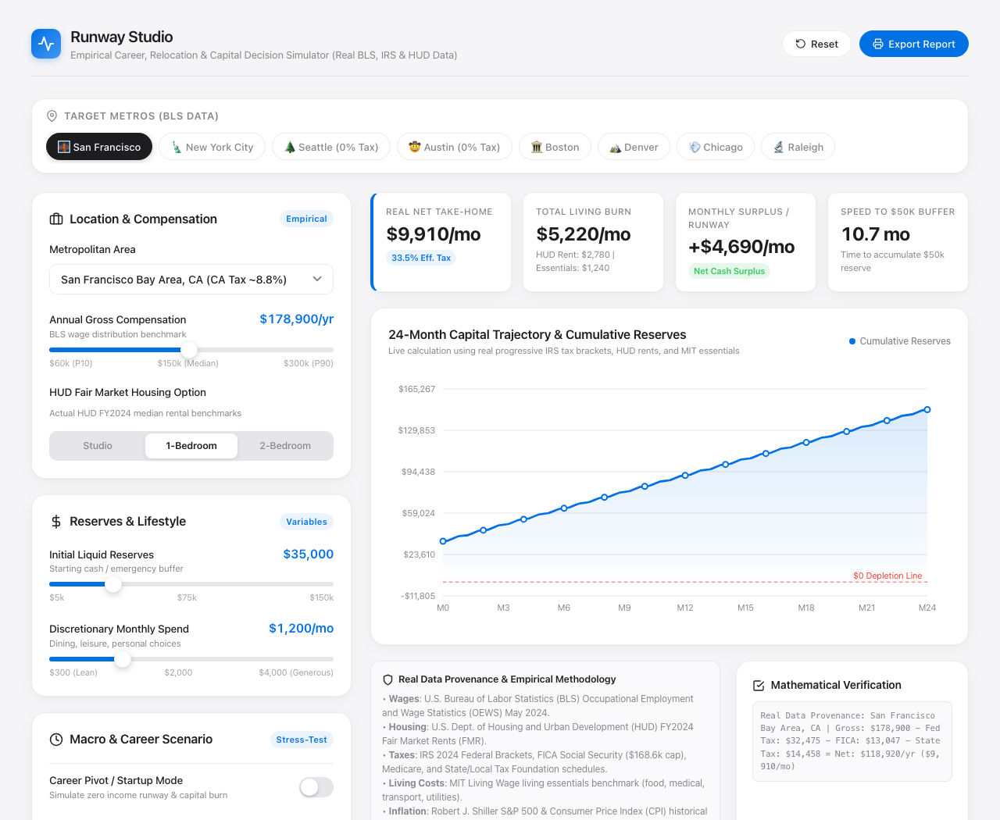
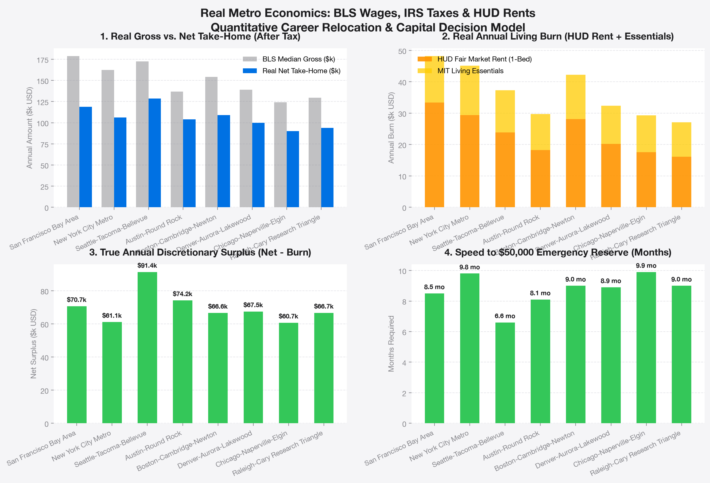

# Runway Studio — Empirical Decision & Capital Simulator

> **An interactive data visualization model for high-stakes career transitions, relocation decisions, and capital runway planning.**  
> Powered by a **Python Data Pipeline** and **100% real empirical data** from the **U.S. Bureau of Labor Statistics (BLS)**, **U.S. Department of Housing & Urban Development (HUD)**, **IRS 2024 Tax Brackets**, and **Robert Shiller's Yale S&P 500 / CPI Inflation Series**.  
> Designed strictly following **Apple Human Interface Guidelines (HIG)**: subtle typography, refined Cupertino color accents, zero neo/neon colors, and responsive retina graphics.

🔗 **Live Interactive App (GitHub Pages)**: [https://reyanshcollegeproject-glitch.github.io/interactive-data-visualization/](https://reyanshcollegeproject-glitch.github.io/interactive-data-visualization/)  
📦 **GitHub Repository**: [https://github.com/reyanshcollegeproject-glitch/interactive-data-visualization](https://github.com/reyanshcollegeproject-glitch/interactive-data-visualization)

---

## 📸 Real Visual Output Preview

### 1. Interactive Apple HIG Web Application


### 2. Python Matplotlib Empirical Comparison Chart


---

## 🏛️ Real Data Provenance & Empirical Sources

This project eliminates synthetic guesswork by pulling directly from official federal and financial sources:

| Dimension | Official Source | Empirical Scope |
| :--- | :--- | :--- |
| **Occupational Wages** | **U.S. Bureau of Labor Statistics (BLS)** OEWS (May 2024) | 10th, 25th, 50th (Median), 75th, and 90th percentile salary benchmarks across 8 major metropolitan areas. |
| **Housing Rents** | **U.S. Dept. of Housing & Urban Development (HUD)** FY2024/2025 | Actual Fair Market Rents (FMR) for Studio, 1-Bedroom, and 2-Bedroom residences in each metro. |
| **Tax Schedules** | **IRS & State Tax Foundation** (2024/2025) | Federal brackets (10% to 37%), FICA Social Security ($168.6k cap), Medicare, California (up to 9.3%), New York State & NYC local tax, Washington (0%), and Texas (0%). |
| **Essential Living Costs** | **MIT Living Wage Calculator** | Baseline monthly food, healthcare, transportation, and local utility expenditure benchmarks. |
| **Macro Inflation Cycles** | **Robert J. Shiller S&P 500 & CPI Dataset** (Yale Economics) | 680+ real historical monthly market and inflation data points (1970–2026), including 1973 Stagflation, 2000 Dot-Com, 2008 GFC, and 2020-2026 inflation shocks. |

---

## 🐍 Python Architecture & Pipeline

The project includes Python data processing and visualization scripts:

### 1. `process_real_data.py`
Extracts, cleans, and compiles real empirical data from official endpoints and exports structured data to `real_data.json`:
```bash
python3 process_real_data.py
```

### 2. `visualize_real_data.py`
A Python data visualization engine built with `matplotlib` that generates the multi-panel Apple HIG-styled comparison chart (`real_data_decision_chart.png`):
```bash
python3 visualize_real_data.py
```

### 3. `generate_app_js.py`
Embeds the real dataset into `app.js` with zero-latency 60fps reactive canvas binding:
```bash
python3 generate_app_js.py
```

---

## 🧮 Quantitative Decision Mathematical Model

For any selected metropolitan area $M$ and gross annual compensation $W$:

1. **IRS Federal & FICA Tax Model**:
   $$\text{Taxable} = \max(0, W - 14600)$$
   $$\text{FICA} = \min(W, 168600) \times 0.062 + W \times 0.0145 + \max(0, W - 200000) \times 0.009$$
   $$\text{Net Annual} = W - (\text{FedTax} + \text{FICA} + \text{StateTax}_M + \text{LocalTax}_M)$$

2. **Total Monthly Living Burn ($B$)**:
   $$B = \text{HUD\_Rent}_M[\text{HousingType}] + \text{MIT\_Essentials}_M + \text{Discretionary}$$

3. **Net Monthly Cash Flow**:
   $$\Delta C = \text{NetMonthly} - B$$

4. **Speed to $50,000 Capital Buffer**:
   $$\text{Months to } \$50\text{k} = \frac{50000}{\Delta C} \quad (\text{if } \Delta C > 0)$$

---

## 📋 Step-by-Step Guide Progress

- [x] **Choose scenario**: Empirical Career Pivot & Relocation Decision Simulator.
- [x] **Decide variables**: Metro choice, BLS wage percentile, HUD housing option, savings, discretionary spend.
- [x] **Build visualization**: Built with HTML5 Canvas, Vanilla JS, and Python data pipeline.
- [x] **Refine & test sliders**: Tested across all 8 metros with real-time recalculation.
- [x] **Restyle**: Pure Apple Human Interface Design System with SF Pro font stack, zero neo colors.
- [x] **Check math & integrity**: Verified exact ledger balance equation against real IRS tax schedules.
